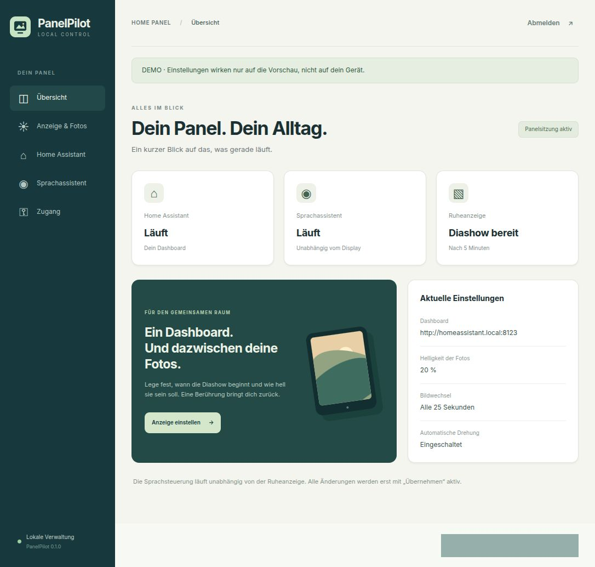

# PanelPilot

Eine kleine, lokale Webverwaltung für einen Linux-Touchscreen mit Home-Assistant-Kiosk,
Foto-Diashow und separatem Linux Voice Assistant. Für Handy und Desktop, mit eigenem
Login und HTTPS. Keine Cloud, keine externen Schriftarten oder Analyse-Dienste.



## Was du einstellen kannst

- Helligkeit für Dashboard und Diashow getrennt
- Ruhezeit, Bildwechsel und Ruhemodus: Fotos, Schwarz oder Dashboard dauerhaft sichtbar
- Fotopfad: lokaler Ordner oder bereits eingebundene Netzwerkfreigabe
- Home-Assistant-URL, einschließlich direktem Dashboard-Pfad
- Voice Assistant dauerhaft ein/aus, auch über Neustarts hinweg
- Automatische Bildschirmdrehung und Verwaltungs-Passwort
- Status der drei Dienste, Foto-Lesetest und gezielter Browserneustart
- Tägliche OS-Updates, Netzbetrieb-Regel und wöchentlicher Neustart mit frei wählbarer Zeit und Zeitzone
- NFS-Verbindung testen, lesend einrichten und als Fotoquelle auswählen
- Fotos vom Handy/Computer hochladen, ansehen und löschen; lokale Galerie ohne NAS

Touch, Maus oder Tastatur beenden die Ruheanzeige. Die Sprachsteuerung läuft unabhängig
weiter. Fotos werden im Hintergrund geladen, vollständig angezeigt und korrekt gedreht.
Verzeichnissymlinks werden mit Schleifen- und Mengenbegrenzung verfolgt. Synology
`@eaDir` und `#recycle` bleiben außen vor.

## Stand und Voraussetzungen

**Version 0.2.0** enthält Webverwaltung, Systemhelfer und einen gemeinsamen Installer.
Getestet auf Zorin OS 18.1 / Ubuntu 24.04, GNOME 46, Wayland und systemd.
Die Anzeige verwendet GNOMEs IdleMonitor und logind. Ohne `/sys/class/backlight`
funktioniert die Ruheanzeige mit Software-Abdunklung der Fotos; die Dashboard-Helligkeit
wird dann am Monitor eingestellt. Andere Desktopumgebungen sind nicht unterstützt.

Der [gemeinsame Installer](docs/SETUP.md) richtet auf Ubuntu Desktop 24.04 / Zorin 18
ein eigenes Kioskkonto, Autologin, Energieverwaltung, Browser, Anzeige, optional Voice
Assistant, Webverwaltung und OS-Wartung ein. Zielarchitekturen sind amd64 und arm64.
Der vollständige frische Installationsablauf und Raspberry-Pi-Hardware sind noch nicht
auf einem zweiten Gerät validiert. Ein HA-Login und das Verbinden der Sprachpipeline
in Home Assistant bleiben einmalige Schritte auf dem Zielsystem.

```sh
sudo python3 scripts/setup.py --install --owner "$USER" \
  --hostname panel.local --url https://homeassistant.example --voice
```

Ohne `--install` erfolgt nur eine Prüfung. Ohne `--voice` wird ein Panel ohne Mikrofonfunktion
installiert. Details: [Ersteinrichtung](docs/SETUP.md), [bestehendes Panel](docs/INSTALLATION.md),
[Betrieb](docs/OPERATIONS.md), [Architektur](docs/ARCHITECTURE.md).

Ein [OS-Wartungsprofil](docs/MAINTENANCE.md) ist enthalten: tägliche stabile
unattended-upgrades und ein wöchentlicher Neustart sonntags um 05:00 Uhr mit Schutz
laufender Paketinstallationen. In Version 0.2 wird es im Webbereich „Updates & Neustart“
verwaltet. Die Webanwendung bleibt unprivilegiert; ein lokaler Systemdienst führt nur
die fest definierten Zeitplan- und NFS-Aktionen aus.

## Demo ohne Hardwareänderungen

```sh
python3 -m venv .venv
.venv/bin/pip install -r requirements.lock
.venv/bin/python -m panelpilot serve --demo --port 8765
```

Öffne `http://127.0.0.1:8765`. Demo-Zugang: **demo / demo-panelpilot**.
Die Demo bindet ausschließlich an Loopback, schreibt nur `.demo-state/` und ruft keine
Paneldienste auf. Die Beispieldaten und das Demo-Passwort werden nie für den echten
Verwaltungsdienst verwendet.

## Entwicklung

```sh
.venv/bin/pip install -e '.[test]'
.venv/bin/python -m unittest discover -s tests -v
```

Die Tests verwenden temporäre Dateien und simulierte Dienstaufrufe. Sie decken Login,
Cookies, CSRF, Origin/Host-Prüfung, Eingabevalidierung, Konflikte zwischen Browsern,
Passwortwechsel, Dienstzustände, Befehlsquotierung und Rücknahme bei Fehlern ab.
Die native Anzeige benötigt zusätzlich die im Installationsdokument genannten GTK-Pakete.

## Veröffentlichen

Dieses Verzeichnis ist das eigenständige Projekt. Nur seinen Quellstand veröffentlichen,
nicht den übergeordneten Einrichtungsordner oder eine lokale Installation.
`scripts/release.py` baut ein Quellarchiv aus einer festen Liste von Projektdateien und
prüft es auf typische private Laufzeitdaten. Die `.gitignore` schließt virtuelle Umgebung,
Zertifikate, Passwörter, Demo-Daten und lokale Einstellungen aus.

```sh
python3 scripts/release.py
```

MIT-Lizenz. Home Assistant, Linux Voice Assistant und die Python-/GTK-Abhängigkeiten
sind eigenständige Projekte mit ihren jeweiligen Lizenzen. Es wird kein fremder
Voice-Assistant-Quellcode mitgeliefert.
